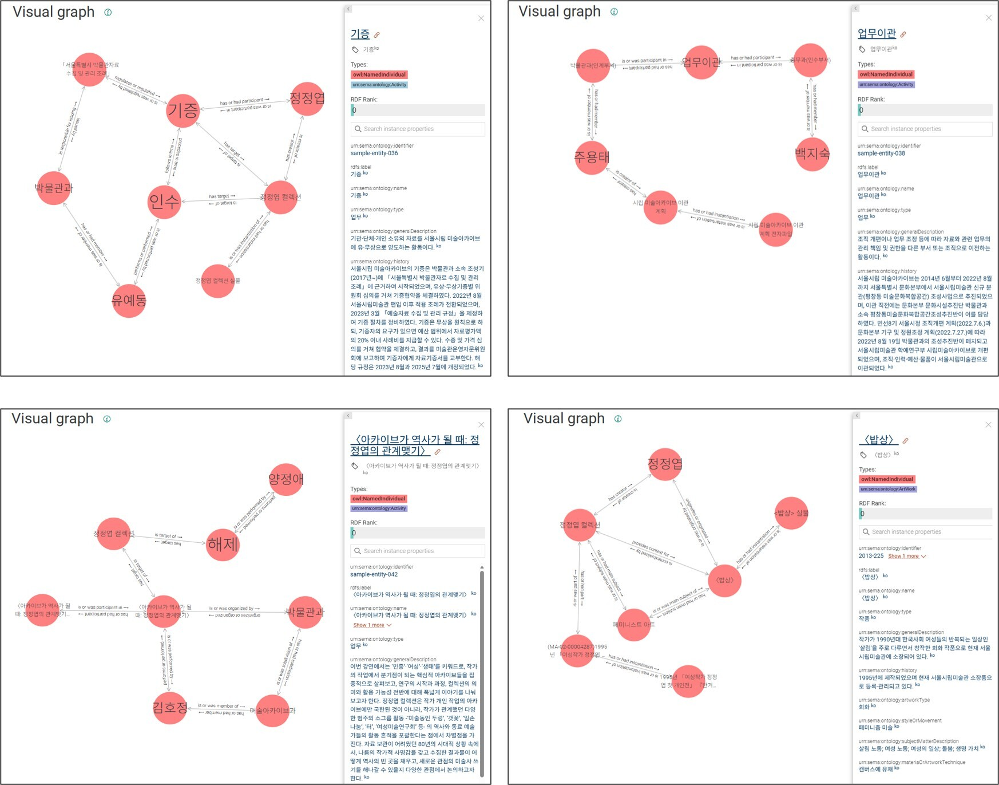
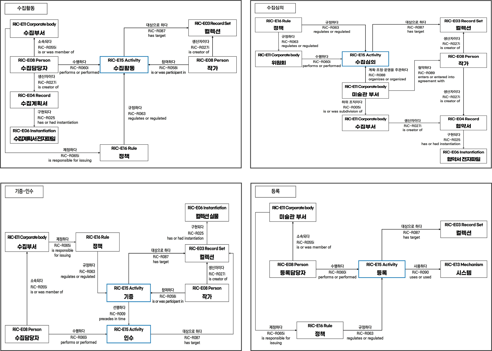
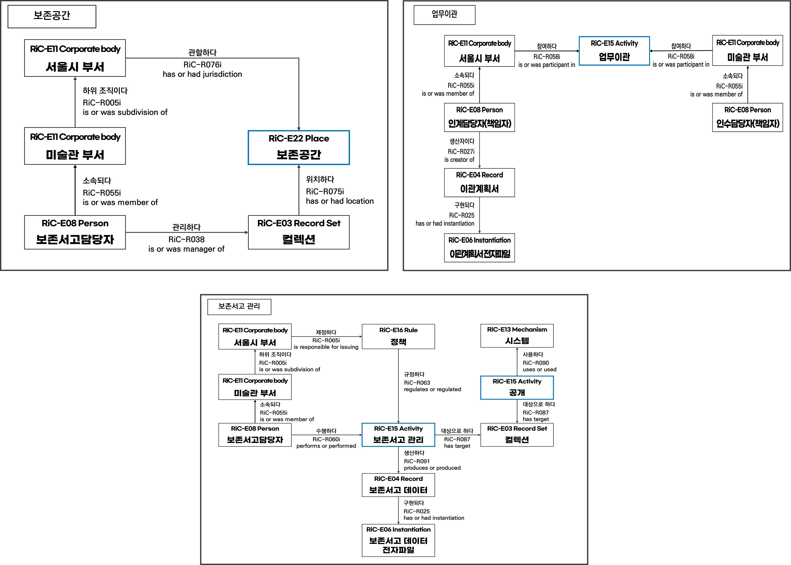
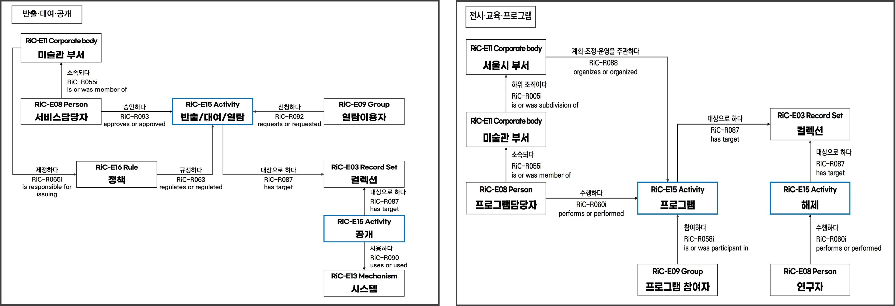
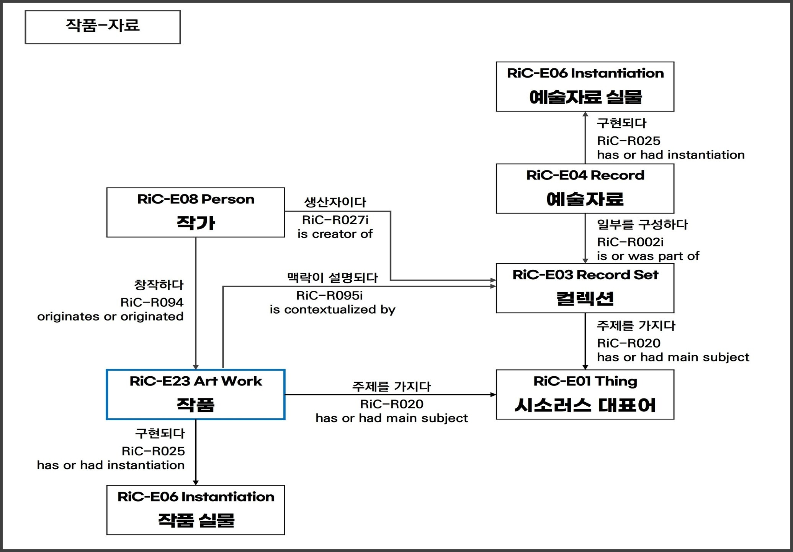
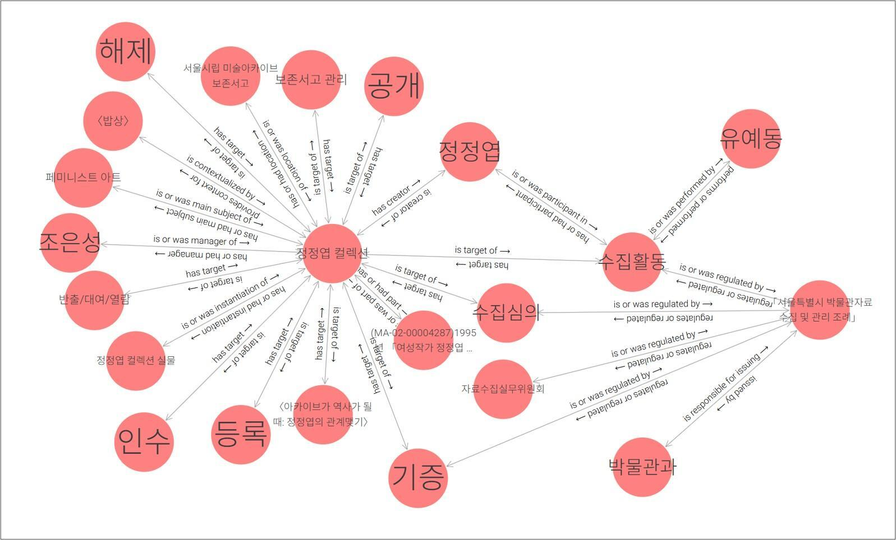

# 컬렉션시각화 Beta

## 1. 개요

서울시립 미술아카이브의 컬렉션시각화 Beta는 소장 컬렉션에 RiC을 적용하여 시각화한 온톨로지 그래프입니다. 컬렉션과 관련된 모든 개념을 원형의 노드(주요 연결점)로 표현하고, 이들을 연결하는 선으로 개념 간의 관계를 나타냈습니다. 여기에는 소장자료, 전거 레코드, 시소러스뿐만 아니라 작품, 부서, 규정 등 기존의 컬렉션시각화에서 연결되지 못했던 개념들까지 모두 포함됩니다. 컬렉션시각화 Beta를 통해 소장자료가 생산되어 컬렉션으로 수집, 활용된 맥락을 한눈에 파악하고 탐색해보세요.

## 2. 컬렉션시각화 Beta의 목적과 대상

- 컬렉션시각화 Beta의 목적
  - 컬렉션 중심에서 업무 중심으로 관계 구조 재구성
    - 수집·등록·관리·활용 등의 업무를 중심으로 개체와 관계를 재구성하여 컬렉션이 형성되고 활용되는 과정을 표현하였습니다.
  - 업무별 핵심 모형을 통한 관계 구조의 명확화
    - 10개의 대표 모형을 통해 업무별 핵심 관계를 유형화하고, 업무 간 공통 구조와 개별 업무의 특성을 구분하였습니다.
  - 미술아카이브의 특성을 반영한 개체·관계 확장
    - RiC-CM을 기반으로 작품(Artwork) 개체와 새로운 관계를 정의하여 업무·작품·예술자료의 맥락을 구체화하였습니다.
- 컬렉션시각화 Beta의 대상
  - 수집부터 관리·활용에 이르는 업무 과정과 작품·예술자료의 다양한 관계를 보여줄 수 있는 '정정엽 컬렉션' 선정
    - 기존 컬렉션시각화 Beta에 RiC-CM을 적용하여 개체와 관계를 구축한 컬렉션
    - 수집·심의·기증·인수·등록 등 컬렉션의 수집 및 등록 과정을 확인할 수 있는 컬렉션
    - 보존공간·업무이관·보존서고 관리 등 소장자료의 관리 이력을 확인할 수 있는 컬렉션
    - 공개·열람·대여 및 전시·교육 프로그램 등 다양한 방식으로 활용된 컬렉션
    - 서울시립미술관의 소장 작품 및 관련 예술자료와 연계할 수 있는 컬렉션
    - 업무 수행과 관련된 인물·부서·규정·시스템 및 기관자료 등의 관계를 확인할 수 있는 컬렉션
    - 현재 컬렉션시각화로 서비스 중인 컬렉션

## 3. 컬렉션시각화 Beta의 구축 절차

- 기존 컬렉션의 개체·관계 분석
  - RiC-CM을 적용한 정정엽·임동식 컬렉션의 개체와 관계를 비교·분석하여 기존 모델링의 특성과 한계를 검토하였습니다. 기존 관계 구조에서 반복적으로 나타나는 개체와 관계를 파악하고, 업무별 모델링에 필요한 핵심 요소를 도출하였습니다.
- 업무별 핵심 모형 도출
  - 수집·등록·관리·활용 등의 업무 과정을 분석하고, 각 업무의 수행 주체·대상·규정·관련 기록을 중심으로 개체와 관계를 재구성하였습니다. 업무 간 공통 구조와 개별 업무의 특성을 반영하여 10개의 핵심 모형을 도출하였습니다.
- 개체·관계·속성의 확장 및 구체화
  - RiC-CM의 기존 요소만으로 표현하기 어려운 업무 및 시각예술 분야의 특성을 검토하고, 필요한 개체·관계·속성을 보완하였습니다. 신규 요소의 정의와 적용 기준을 정리하고, 정정엽 컬렉션의 실제 데이터를 적용하여 모형의 적합성을 검토하였습니다.
- 핵심 모형의 RiC-CM 매핑 및 신규 개체·관계 정의
  - 업무별 핵심 모형을 RiC-CM의 개체(entity)·관계(relation)·속성(attribute)에 따라 매핑하고, 기존 표준만으로 표현하기 어려운 업무 및 시각예술 분야의 특성을 반영하여 신규 개체 1종과 관계 9종을 정의하였습니다.
  - 신규 개체와 관계의 정의 및 적용 기준을 정리하고, 정정엽 컬렉션의 실제 데이터를 용하여 적합성을 검토하였습니다.
- 신규 개체(Entity)

| 개체&nbsp;ID | 개체명 | 개체의&nbsp;유형 | 정의 |
| :---: | :---: | :---: | :---: |
| RiC&#8209;E23 | Artwork | 작품 | 예술적 활동을 통해 구상되거나 제작된 개별 예술 창작물로서, 물리적·전자적 구현형과 구분되는 식별 가능한 작품 개체 |

- 신규 관계(Relation)

| 관계&nbsp;ID | 관계명 | 한글명 |
| :---: | :---: | :---: |
| RiC&#8209;R087 | has target | 대상으로 하다 |
| RiC&#8209;R088 | organizes or organized | 계획·조정·운영을 주관하다 |
| RiC&#8209;R089 | enters or entered into agreement with | 협약하다 |
| RiC&#8209;R090 | uses or used | 사용하다 |
| RiC&#8209;R091 | produces or produced | 생산하다 |
| RiC&#8209;R092 | requests or requested | 신청하다 |
| RiC&#8209;R093 | approves or approved | 승인하다 |
| RiC&#8209;R094 | originates or originated | 창작하다 |
| RiC&#8209;R095 | provides context for | 맥락을 제공하다 |

## 4. 컬렉션시각화 Beta의 업무별 핵심 모형

- 업무별 핵심 모형의 구성
  1. 기존 컬렉션의 개체·관계 분석 결과를 바탕으로 수집·등록·관리·활용 등의 업무 과정과 작품·예술자료의 관계를 10개의 핵심 모형으로 유형화하였습니다. 각 모형은 업무별 수행 주체·대상·규정·관련 기록 등의 공통 구조를 기반으로, 개별 업무의 특성에 따른 개체와 관계를 추가하여 구성하였습니다. (※ 업무별 핵심 모형에는 수집·관리·활용 등의 활동을 중심으로 구성한 모형과 작품·예술자료 및 보존공간의 관계를 중심으로 구성한 모형이 포함되어 있습니다.)

  2. 핵심 업무 모형은 다음의 4개 영역으로 구분할 수 있습니다.

  3. 수집 및 등록 : 수집활동, 수집심의, 기증·인수, 등록

  4. 관리 및 운영 : 보존공간, 업무이관, 관리 및 운영

  5. 공개 및 활용 : 전시·교육·프로그램, 반출·대여·공개

  6. 작품·예술자료 : 작품·자료

- 수집 및 등록 : 컬렉션의 수집 과정에서 발생하는 활동과 관계

- 관리 및 운영 : 보존공간, 조직 간 업무이관, 관리 활동의 관계

- 공개 및 활용 : 컬렉션의 연구·활용과 이용자 서비스 관련 관계

- 작품과 예술자료 : 작가·작품·컬렉션·예술자료의 맥락적 관계

- RiC-CM 매핑 데이터의 RiC-O 전환 및 시각화
  - RiC-CM 매핑 데이터를 온톨로지 그래프로 시각화하기 위해서는 RDF 형태의 RiC-O로 전환해야 합니다. ICA가 RiC-O의 구성 요소를 구조화한 기본 파일을 RDF로 배포하고 있기 때문입니다.
  - 먼저 RiC-O의 주석 프로퍼티(annotation property) ‘rico:RiCCMCorrespondingComponent’를 통해 RiC-CM의 개체, 속성, 관계를 RiC-O의 클래스(class)와 프로퍼티(datatype property, object property)로 변환했습니다. 그 결과를 Python의 openpyxl로 엑셀 데이터를 읽고 rdflib를 통해 RDF 데이터로 변환한 후 온톨로지 시각화 도구 ‘그래프 디비(GraphDB)’에 반입하여 개체 간 관계를 시각화하였습니다.

## 5. 컬렉션시각화 Beta의 탐색

- 적용 표준: RiC-CM(v1.0), RiC-O(v1.1)
- 구축 대상: 정정엽 컬렉션
  - [핵심 업무 모형 온톨로지 그래프 바로가기(클릭) - 시작점: 정정엽 컬렉션](http://121.131.4.200:7200/graphs-visualizations?saved=97f9fecb6cbe46c2aaa6205d372d5721)
    - 동일한 운영 환경 설정을 위해 로그인이 필요합니다. (아이디: user / 비밀번호: semaaa)
    - 그래프가 바로 표출되지 않는 경우, 화면 좌측 ‘Explore &gt; Visual graph’ 메뉴의 ‘Saved graphs’에서 시작점별 ‘정정엽 컬렉션’을 선택해 주시기 바랍니다.
- 활용 도구: 시맨틱 그래프 데이터베이스 ‘그래프 디비(GraphDB)’
- 탐색 방법: 마우스 클릭으로 그래프 조작
  - 노드를 클릭하면 해당 노드의 상세정보를 확인할 수 있습니다.
  - 노드를 더블클릭하거나 마우스 오버 시 나타나는 ‘확장(expand)’ 버튼을 클릭하면 해당 노드에 관계로 연결된 노드들이 추가로 표출되며 그래프가 확장됩니다.
  - 노드에 마우스 오버 시 나타나는 ‘초점(focus)’ 버튼을 클릭하면 해당 노드를 중심으로 그래프가 새로 만들어집니다.
  - 노드를 연결하는 선 위에는 관계가 표기되어 있습니다. 2개 이상의 관계는 가독성을 위해 함축적으로 표기되며, 선을 클릭하면 모든 관계들을 확인할 수 있습니다.
    - 텍스트를 읽는 방향에 따라 관계의 주어와 목적어를 파악할 수 있습니다. (예: 주어 → 목적어)
  - 우측 상단의 돋보기 모양 아이콘을 선택해 노드를 검색할 수 있습니다.

## 6. 컬렉션시각화 Beta의 의의

- 업무 중심 관계 구조의 구체화
  - 컬렉션 관련 정보를 확장하여 연결하던 기존 모형을 바탕으로, 업무별 수행 주체·대상·근거·기록의 관계를 정리하여 개별 업무의 구조를 파악할 수 있도록 하였습니다.
- 업무별 핵심 모형의 유형화
  - 10개의 핵심 모형을 도출하고, 여러 업무에서 반복되는 공통 구조와 업무별 고유 관계를 구분함으로써 다른 컬렉션에도 적용할 수 있는 기초 모델을 마련하였습니다.
- 미술아카이브 특화 개체·관계의 확장
  - RiC-CM의 기존 요소를 활용하면서 업무 및 시각예술 분야에서 필요한 개체와 관계를 정의하고, 적용 기준을 구체화하였습니다.
- 연구의 한계와 향후 과제
  - 정정엽 컬렉션을 대상으로 구축한 시범 모형인 만큼 다른 컬렉션과 업무에도 적용하여 타당성을 검토할 필요가 있습니다. 또한 실제 서비스 환경에서 관계의 가독성과 탐색 편의성을 검증하고, 기존 미술아카이브 데이터와의 연계 방안을 지속적으로 검토해야 합니다.

## 선행연구

- 임동식 컬렉션을 대상으로 구축한 컬렉션시각화 Beta는 [SeMA AA 깃허브 계정(클릭)](https://github.com/SeMA-AA)에서 확인할 수 있습니다.

## 문의

- semaaa@seoul.go.kr
- 02-2124-7400
